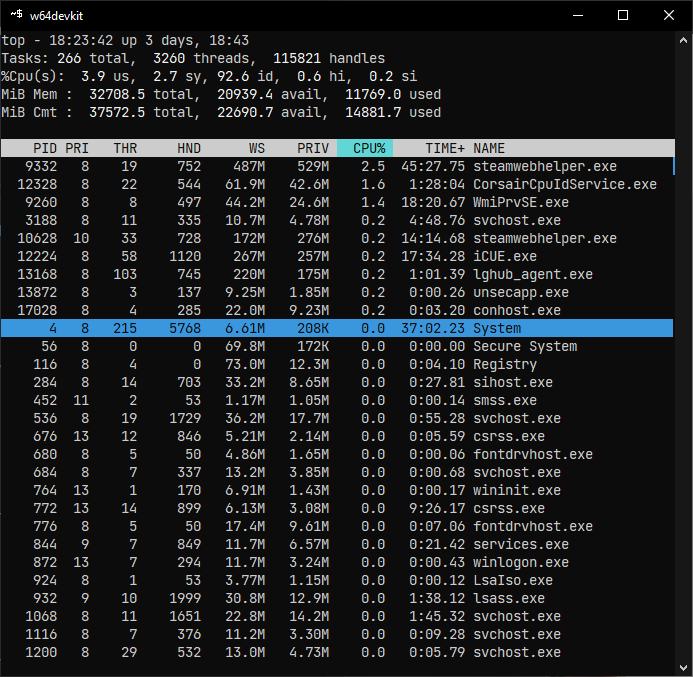
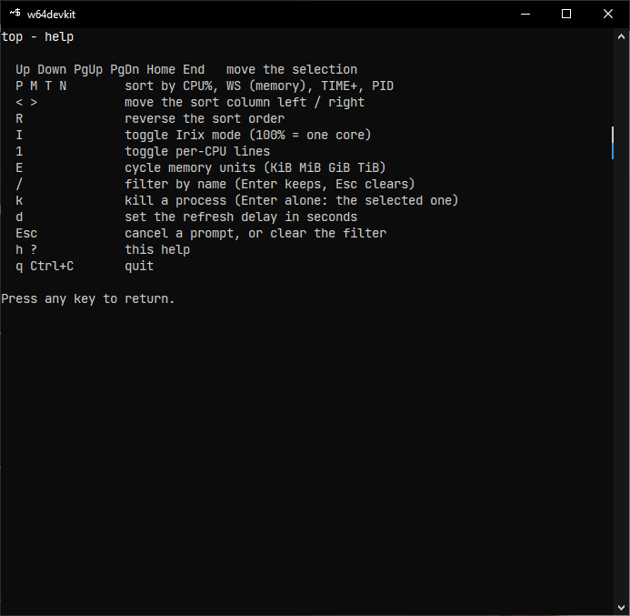
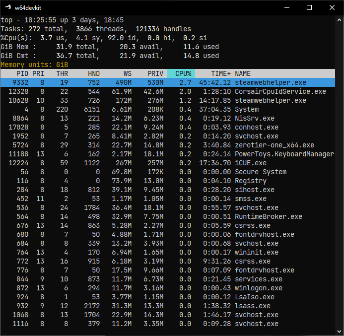
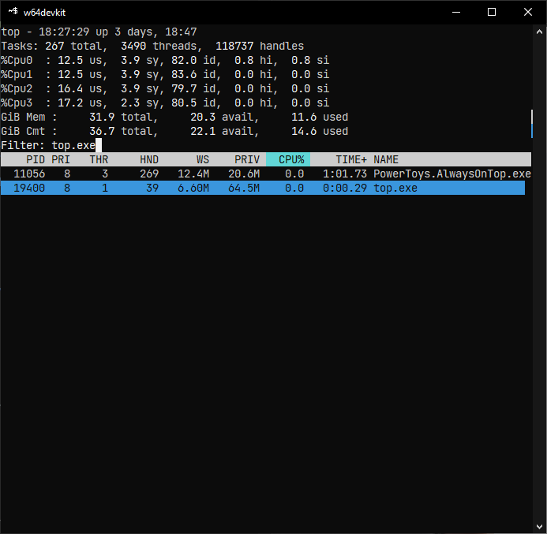

# top

top(1) for Windows: a live, sortable view of processes, CPU and memory in the
console.

It's a single 34 KB .exe that needs only kernel32.dll and ntdll.dll, which
every Windows install has. There's no runtime or redistributable to install
alongside it. Copy it to a machine and run it.

It doesn't use the C runtime or the Windows headers either, so building it
takes nothing but a C compiler. There's no Visual Studio or Windows SDK to
install. Even tcc, a compiler that installs in a couple of megabytes, can
build it.

## Build

Needs `gcc` and `make`, such as from [w64devkit][].

    make                 # top.exe
    make top-debug.exe   # debug info, UBSan traps, guard pages

It also builds with [tcc][], which must be on the PATH:

    make top-tcc.exe

## Usage

    top [-b] [-d SECS] [-n N]
      -b       batch mode: print plain-text snapshots to stdout
      -d SECS  refresh delay in seconds (default 2, minimum 0.1)
      -n N     batch mode: exit after N snapshots (default: run forever)
      -h       print this message

Interactive keys: arrows, PgUp, PgDn, Home and End move the selection.  `P` `M`
`T` `N` sort by CPU, memory, time and PID; `<` `>` move the sort column and `R`
reverses it. `/` filters by name, `k` kills a process, `d` sets the delay, `1`
toggles per-CPU lines, `I` toggles Irix mode, `E` cycles memory units, `h`
shows help, `q` quits.

`E` switches the memory units, here to GiB:

`/` filters the list by name, and `1` splits the CPU line per core:

## Layout

    main.c     entry point, arguments, batch and console loops
    base.c     types, arena, strings, UTF conversion, buffered output
    win32.c    hand-written Win32 and NT declarations
    sample.c   CPU, process and memory sampling
    ui.c       interactive display and batch output
    test.c     randomized tests

It is a unity build: main.c includes the other files, and test.c includes all
of them but main.c.

## Testing

    make test

Without the C runtime, `top` does its own number formatting, text parsing and
UTF-8/UTF-16 conversion, so the bugs a C library would normally absorb are its
own. The tests go looking for them. They feed the UI made-up process lists full
of hostile values (NaN and infinite CPU times, huge counts, malformed and very
long names), random keystrokes and odd console sizes, and check every frame and
every line of batch output. The string and number code is checked against
simpler reference versions, and the process-list walk against corrupted kernel
buffers.

The tests run with the debug checks on, so an out-of-bounds access crashes
right where it happens instead of quietly printing garbage. Killing a process
is stubbed out, so nothing on your machine is touched.

A failure prints its seed and iteration, and `top-test.exe -s SEED -i ITER -n
1` replays exactly that case. `make top-test-tcc.exe` builds the same tests
with tcc.

[w64devkit]: https://github.com/skeeto/w64devkit
[tcc]: https://bellard.org/tcc/
